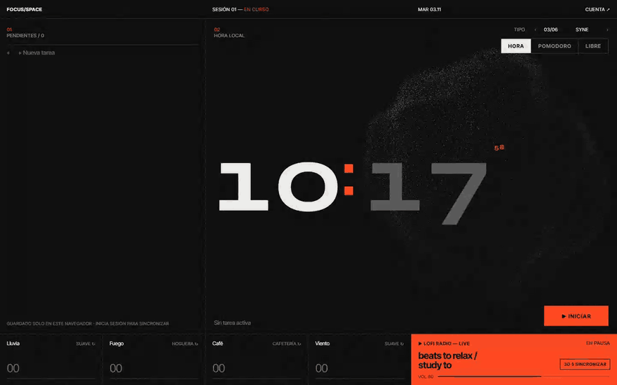
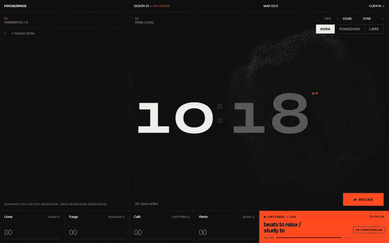

<div align="center">

# Focus/Space

**Una sala de concentración para el escritorio: tareas, temporizador Pomodoro, ambientes mezclables, radio lofi y una esfera de partículas que reacciona a lo que escuchas.**

[English](README.md) · **Español**

[](LICENSE)
[](https://react.dev)
[](https://www.typescriptlang.org)
[](https://vite.dev)
[](https://threejs.org)
[](https://supabase.com)
[](https://bun.sh)
[](#scripts)
[](#funciones)
[](#funciones)
[](#contribuir)

<br />



</div>

---

## Por qué

Casi todas las apps de concentración son o un temporizador pelado o un panel lleno de cosas que configurar. Focus/Space está en medio: **una sola pantalla** con todo lo necesario para meterte en una sesión, sin cuenta obligatoria, y con un aspecto lo bastante tranquilo como para dejarla abierta todo el día en un segundo monitor.

- **Cero configuración.** Clonas, instalas y arrancas. Sin nada configurado funciona en *modo solo local* y guarda en tu navegador.
- **Sin registro.** Las cuentas son opcionales y solo añaden sincronización entre dispositivos.
- **Hecha para dejarla abierta.** Oscura, silenciosa, con tipografía editorial y una escena 3D que respira con el sonido.

## Funciones

| | |
|---|---|
| ⏱️ **Pomodoro y temporizador libre** | Ciclos clásicos de 25 / 5 min con un descanso largo de 15 min cada 4 sesiones, o un temporizador libre de 1 a 240 min. Un aviso suave marca el final de cada fase. |
| 🕐 **Hora local por defecto** | Abre mostrando la hora. Con un temporizador en marcha, la hora sube en pequeño y la cuenta atrás pasa al centro. |
| ✅ **Tareas** | Añade, edita, completa y borra. Marca una como *activa* y aparece bajo el temporizador, para saber siempre para qué es esta sesión. |
| 🌧️ **Mezclador de ambientes** | Lluvia, fuego, café, viento y teclado, cada uno con variantes (ventana, tormenta, tienda, chimenea, biblioteca, bosque, Cherry MX Blue, Brown y Red…). Arrastra, usa la rueda o las flechas para mezclarlos. |
| 📻 **Radio lofi** | Un directo de lofi con su propio volumen y cambio automático a otro directo si uno se cae. |
| 🔮 **Esfera de partículas reactiva** | Una esfera con shaders en Three.js que sigue a los canales de ambiente. |
| 🔤 **Seis tipografías para el reloj** | Suiza, Grotesk, Syne, Editorial, Mono y Unbounded, ajustadas para que los dígitos ocupen siempre el mismo ancho. |
| ☁️ **Sincronización opcional** | Inicia sesión con email (enlace mágico), Google o GitHub mediante Supabase. Las tareas que creaste antes de entrar se fusionan con tu cuenta. |
| 🌐 **Español e inglés** | Elige el idioma en Ajustes. Empieza con el de tu navegador y se recuerda. |
| ♿ **Accesible** | Roles y etiquetas reales en cada control, deslizadores manejables con teclado y un temporizador legible por lectores de pantalla. |

<table>
  <tr>
    <td width="50%" valign="top">
      
      <p align="center"><b>Tareas + temporizador libre</b><br /><sub>La tarea activa te acompaña durante la sesión.</sub></p>
    </td>
    <td width="50%" valign="top">
      
      <p align="center"><b>Mezclador de ambientes</b><br /><sub>La esfera se mueve con cada canal que subes.</sub></p>
    </td>
  </tr>
  <tr>
    <td colspan="2">
      
      <p align="center"><b>Seis tipografías para el reloj</b><br /><sub>Elige la que mejor encaje con tu mesa.</sub></p>
    </td>
  </tr>
</table>

## Empezar

Necesitas una versión reciente de [Bun](https://bun.sh).

```bash
git clone https://github.com/envyx10/focus-space.git
cd focus-space
bun install
bun run dev
```

Abre <http://localhost:5173> y listo: las tareas y preferencias se guardan en tu navegador.

> **Consejo:** los navegadores bloquean el audio hasta que interactúas con la página. Haz clic en cualquier sitio una vez y empezarán a sonar los ambientes.

### Cuentas y sincronización (opcional)

Para sincronizar tareas entre dispositivos necesitas un proyecto gratuito de [Supabase](https://supabase.com):

1. Ejecuta [`supabase/schema.sql`](supabase/schema.sql) en el editor SQL de Supabase.
2. Copia `.env.example` a `.env.local` y rellena la URL del proyecto y la clave `anon`:

   ```env
   VITE_SUPABASE_URL=https://<project-ref>.supabase.co
   VITE_SUPABASE_ANON_KEY=<anon-public-key>
   ```

3. Reinicia `bun run dev`. El menú **Cuenta** ya te deja iniciar sesión.

La guía completa (email, Google, GitHub y despliegue en Netlify) está en [docs/SETUP.md](docs/SETUP.md).

## Scripts

| Comando | Qué hace |
|---|---|
| `bun run dev` | Servidor de desarrollo con recarga en caliente |
| `bun run build` | Comprueba tipos y compila a `dist/` |
| `bun run preview` | Sirve en local la versión de producción |
| `bun run test` | Ejecuta los tests (Vitest + Testing Library) |
| `bun run lint` | Pasa el linter (oxlint) |

## Cómo funciona

```
src/
├── timer/    Pomodoro y temporizador libre: máquina de estados pura + hook de React
├── tasks/    Lista de tareas con un repositorio local (localStorage) y otro en Supabase
├── audio/    Motor Web Audio, mezclador, análisis de niveles y captura del audio de la pestaña
├── lofi/     Reproductor lofi de YouTube con directos de reserva
├── visual/   Esfera de partículas en Three.js, shaders GLSL, tipografías y grano
├── auth/     Sesión de Supabase y menú de cuenta
├── prefs/    Volúmenes, variantes y tipografía, guardados en el navegador
└── layout/   Cabecera
```

- **El temporizador** guarda la hora de fin real en lugar de contar ticks, así que sigue exacto en pestañas en segundo plano y sobrevive a una recarga.
- **La esfera** lee los niveles de un `AnalyserNode` de Web Audio en cada canal de ambiente. El iframe de YouTube no se puede analizar directamente, así que mientras suena el lofi sigue un ritmo sintético.
- **Three.js se carga después del primer pintado**, así que el reloj y las tareas aparecen al instante.
- **Las tareas funcionan primero en local.** La primera vez que inicias sesión, las tareas del navegador se fusionan con tu cuenta (en caso de conflicto gana la copia remota y se descartan los duplicados).

## Tecnologías

[React 19](https://react.dev) · [TypeScript](https://www.typescriptlang.org) · [Vite](https://vite.dev) · [Three.js](https://threejs.org) + GLSL · Web Audio API · [Supabase](https://supabase.com) (Auth + Postgres con RLS) · [Vitest](https://vitest.dev) + [Testing Library](https://testing-library.com) · [oxlint](https://oxc.rs) · [Bun](https://bun.sh) · [Netlify](https://netlify.com)

## Contribuir

Es un proyecto pequeño y las contribuciones son bienvenidas: nuevos ambientes, tipografías, escenas, traducciones o arreglos.

1. Haz un fork y crea una rama: `git checkout -b feat/mi-idea`
2. Haz tu cambio y mantén en verde `bun run test` y `bun run lint`
3. Abre una pull request explicando qué cambia y por qué

¿Ideas o fallos? [Abre un issue](https://github.com/envyx10/focus-space/issues).

## Créditos

- Los ambientes son grabaciones reales **CC0** de [Freesound](https://freesound.org). Cada archivo y su autor están en [public/sounds/CREDITS.md](public/sounds/CREDITS.md).
- La radio lofi se emite desde YouTube y pertenece a sus creadores.
- Fuentes de [Google Fonts](https://fonts.google.com).

## Licencia

Código bajo licencia [MIT](LICENSE). Los sonidos mantienen su propia licencia (CC0).

<div align="center">
<sub>Hecha para sesiones largas de concentración. Si te sirve, una ⭐ ayuda a que otros la encuentren.</sub>
</div>
