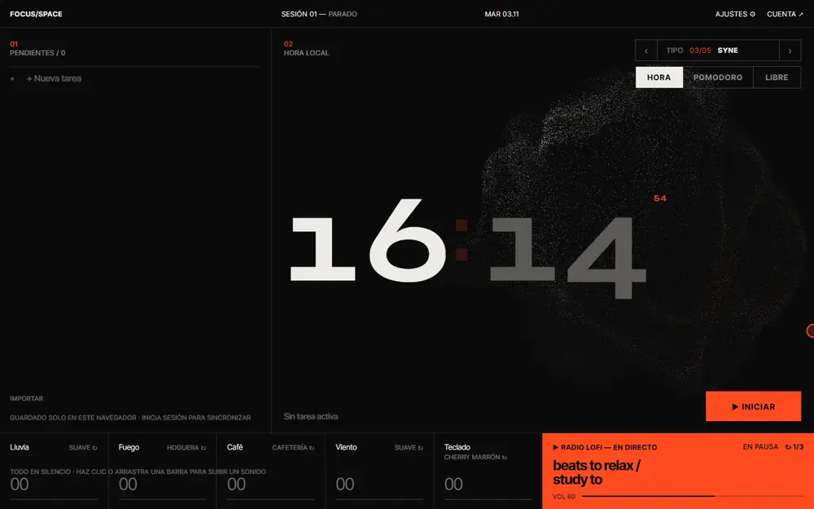
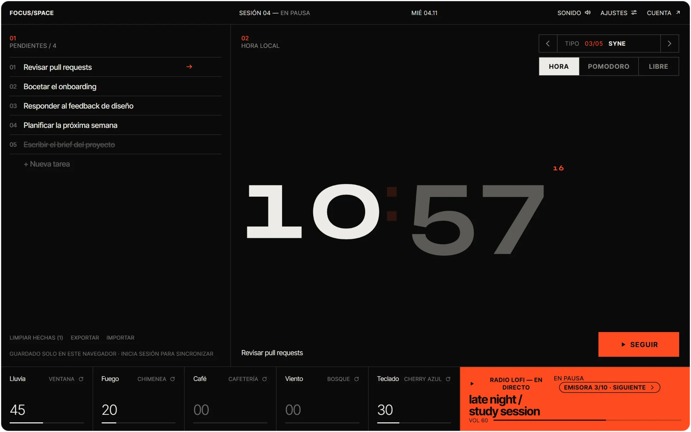
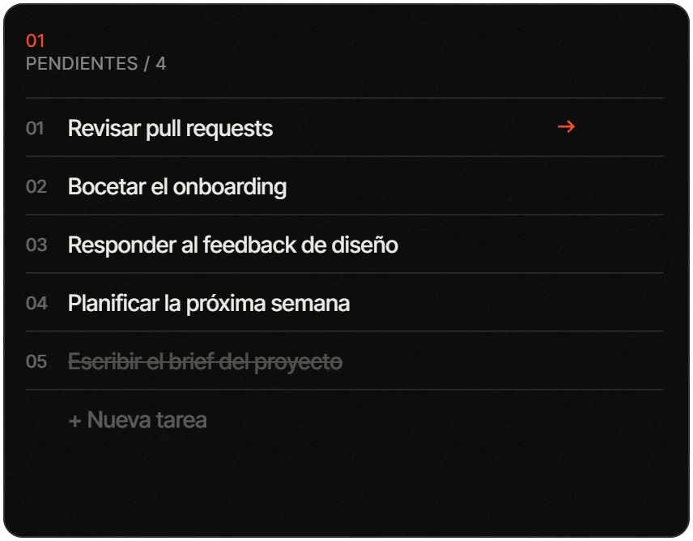
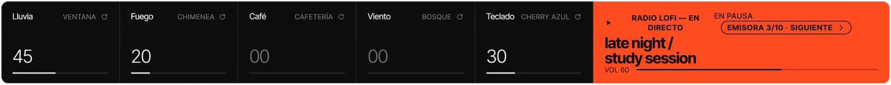
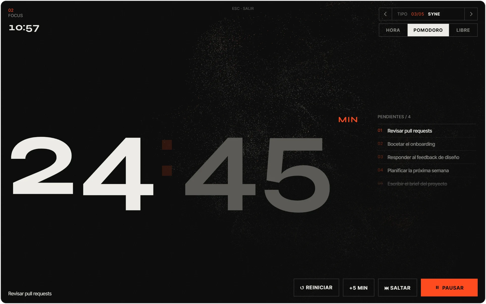
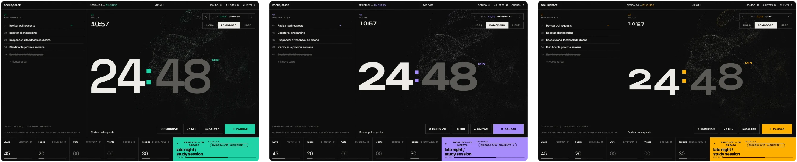
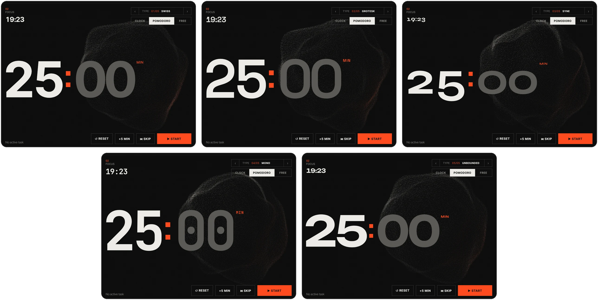
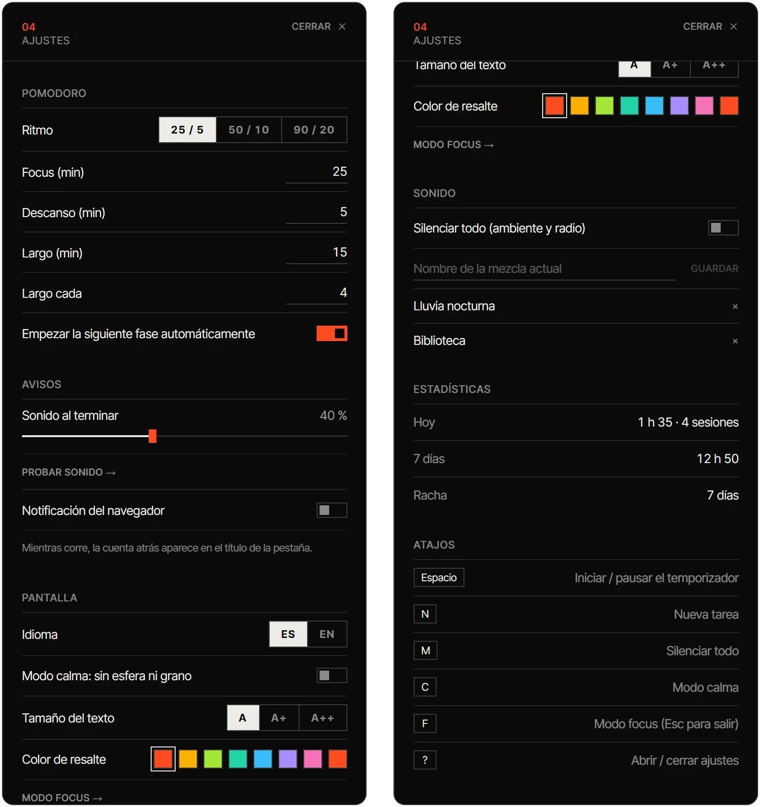
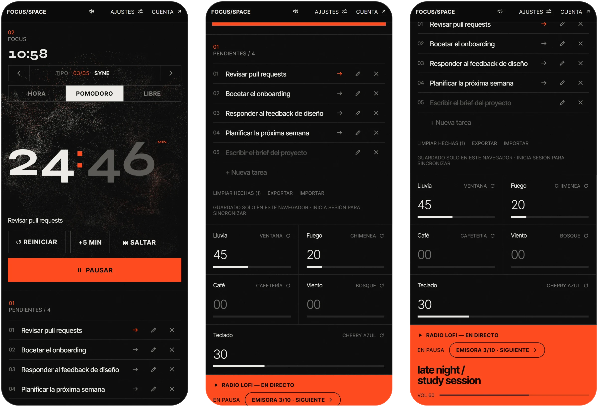

<div align="center">


# Focus/Space

### Una sala tranquila para concentrarte, en una pestaña del navegador.

Tareas, temporizador Pomodoro, un mezclador de sonidos ambientales, radio lofi y una esfera de partículas que se mueve con lo que escuchas.<br />
Todo en una sola pantalla. Sin cuenta, sin configurar nada.

<br />

[](#créditos-y-licencias)
[](public/sounds/CREDITS.md)
[](#tecnologías)
[](#los-detalles)

[English](README.md) · **Español**

<sub>[La idea](#la-idea) · [Funciones](#funciones) · [Inicio rápido](#inicio-rápido) · [Cómo funciona](#cómo-funciona) · [Contribuir](#contribuir)</sub>

<br />



<sub>Una sesión en marcha: tareas a la izquierda, reloj y esfera en el centro, mezclador y radio abajo.</sub>

</div>

<br />

## La idea

La mayoría de apps de concentración son un simple temporizador o un panel lleno de ajustes. Focus/Space está en medio. Pone **todo lo que necesitas para empezar una sesión en una sola pantalla**, y es lo bastante tranquila para dejarla abierta todo el día en un segundo monitor.

Abres la pestaña, eliges en qué vas a trabajar, arrancas el reloj y subes un poco la lluvia. Esa es toda la rutina.

<table>
  <tr>
    <td width="33%" valign="top">
      <b>Una sola pantalla</b><br />
      <sub>Temporizador, tareas, sonido y radio comparten una vista. Nada de menús antes de empezar.</sub>
    </td>
    <td width="33%" valign="top">
      <b>Sin registrarte</b><br />
      <sub>Funciona al momento y guarda en tu navegador. La cuenta es opcional y solo añade sincronización.</sub>
    </td>
    <td width="33%" valign="top">
      <b>Hecha para quedarse abierta</b><br />
      <sub>Oscura, silenciosa y exacta: el temporizador sobrevive a una recarga y no se desfasa en segundo plano.</sub>
    </td>
  </tr>
</table>

<br />

<a id="funciones"></a>

<sub>01 — TEMPORIZADOR</sub>

## Tres formas de medir el tiempo

Un reloj grande ocupa el centro de la pantalla. Cambia entre sus tres modos con un clic.

| Modo | Qué hace |
|---|---|
| **Hora** | Muestra la hora local, grande y legible desde el otro lado de la habitación. |
| **Pomodoro** | 25 / 5 con un descanso largo cada 4. Ritmos de 50 / 10 y 90 / 20, o tus propias duraciones. |
| **Libre** | Una cuenta atrás sencilla de 1 a 240 minutos. |

- **Tú mandas.** Añade 5 minutos, salta una fase o evita que la siguiente empiece sola.
- **A prueba de recargas.** La fase en marcha se guarda con su hora de fin, así que cerrar la pestaña no la pierde.
- **Avisos a tu medida.** Cuenta atrás en el título de la pestaña, notificación del navegador opcional y un sonido con volumen propio, hasta *apagado*.
- **Estadísticas.** Tiempo de foco hoy y en los últimos 7 días, y tu racha actual.

<div align="center">

<br /><sub><b>Vista Hora con el modo calma activado.</b> La esfera y el grano de película se apartan para una pantalla aún más tranquila.</sub>
</div>

<br />

<sub>02 — TAREAS</sub>

## Una lista corta, siempre a la vista

<table>
  <tr>
    <td width="44%" valign="top">
      
    </td>
    <td valign="top">
      <p>Apunta lo que vas a hacer y marca una tarea como <b>activa</b>. Te acompaña bajo el reloj, para que sepas siempre para qué es esta sesión.</p>
      <ul>
        <li>Añade, edita (<kbd>✎</kbd> o doble clic), completa y borra.</li>
        <li><b>Deshaz</b> un borrado con el botón o con <kbd>Ctrl</kbd>/<kbd>⌘</kbd> + <kbd>Z</kbd>.</li>
        <li><kbd>Retroceso</kbd> en la caja vacía de nueva tarea borra la última.</li>
        <li>Limpia las completadas, <b>exporta</b> a JSON e <b>importa</b> JSON o una lista de texto (una por línea; sirven los <code>- [x]</code>).</li>
        <li>Primero local. Inicia sesión (opcional) para sincronizar entre dispositivos.</li>
      </ul>
    </td>
  </tr>
</table>

<br />

<sub>03 — SONIDO</sub>

## Tu propio fondo, mezclado a mano

Cinco canales ambientales que puedes superponer, cada uno con grabaciones reales para elegir. A su lado, una radio lofi con volumen propio.

<div align="center">

</div>

<br />

<table>
  <tr>
    <td width="50%" valign="top">
      <b>Mezclador de ambientes</b>
      <ul>
        <li><b>Lluvia</b> (suave, ventana, tormenta, tienda), <b>fuego</b> (hoguera, chimenea), <b>café</b> (cafetería, biblioteca), <b>viento</b> (suave, bosque) y <b>teclado</b> grabado con interruptores Cherry MX Blue, Brown y Red.</li>
        <li>Mezcla con un clic, arrastrando, con la rueda del ratón o con las flechas.</li>
        <li><b>Guarda mezclas</b> con nombre y cambia entre ellas.</li>
        <li><b>Silencia todo</b> con <kbd>M</kbd>. La cabecera indica cuándo el sonido está apagado.</li>
      </ul>
    </td>
    <td width="50%" valign="top">
      <b>Radio lofi</b>
      <ul>
        <li><b>Diez emisoras</b>: beats para estudiar de madrugada, lofi jazz de cafetería, café con lluvia, lofi gamer, piano Disney y más.</li>
        <li>Volumen propio, independiente de la mezcla ambiental.</li>
        <li>Si un directo se cae, la radio salta sola a la siguiente emisora.</li>
      </ul>
    </td>
  </tr>
</table>

<br />

<sub>04 — MODO FOCUS</sub>

## Todo lo demás desaparece

Pulsa <kbd>F</kbd> y la interfaz se retira. El reloj crece hasta llenar la pantalla, el navegador pasa a pantalla completa y tu lista de tareas se queda a un lado como una columna discreta de solo lectura. <kbd>Esc</kbd> lo devuelve todo.

<div align="center">

</div>

**La esfera.** Detrás del reloj, una esfera de Three.js con 65.536 partículas (32.400 en equipos con 4 núcleos o menos) se simula por completo en la GPU. Sigue el nivel de cada canal ambiental y el ritmo de la radio lofi, así que la pantalla respira con lo que escuchas.

<br />

<sub>05 — PERSONALIZACIÓN</sub>

## Haz tuya la sala

<div align="center">

<br /><sub><b>Cualquier color de resalte.</b> Siete opciones rápidas o el color que quieras. El texto sobre el resalte cambia entre oscuro y claro para seguir siendo legible.</sub>
</div>

<br />

<div align="center">

<br /><sub><b>Cinco tipografías para el reloj.</b> Swiss, Grotesk, Syne, Mono y Unbounded, cada una ajustada para que los dígitos ocupen el mismo ancho.</sub>
</div>

<br />

<table>
  <tr>
    <td width="50%" valign="top">
      
    </td>
    <td width="50%" valign="top">
      <b>Ajustes, todo en un panel</b> <kbd>?</kbd>
      <ul>
        <li><b>Ritmo del Pomodoro</b>: ritmos predefinidos o tus propias duraciones de foco, descanso y descanso largo.</li>
        <li><b>Avisos</b>: volumen del sonido y notificaciones del navegador.</li>
        <li><b>Pantalla</b>: idioma, modo calma, tres tamaños de texto y el color de resalte.</li>
        <li><b>Sonido</b>: silenciar todo y gestionar tus mezclas guardadas.</li>
        <li><b>Estadísticas</b>: hoy, los últimos 7 días y tu racha.</li>
        <li><b>Atajos</b>: un recordatorio de cada tecla.</li>
      </ul>
      <sub>Todo se recuerda en tu navegador.</sub>
    </td>
  </tr>
</table>

<br />

<sub>06 — MÓVIL</sub>

## También en el móvil

Por debajo de 1024&nbsp;px el diseño pasa a una sola columna: reloj, tareas, mezclador y radio, con controles a todo el ancho y zonas táctiles cómodas. Incluye un manifiesto de app web, así que puedes añadirla a tu pantalla de inicio.

<div align="center">

</div>

<br />

<a id="los-detalles"></a>

## Los detalles

**Español e inglés.** Elige el idioma en Ajustes. Empieza con el de tu navegador y se recuerda.

**Accesible desde el diseño.** Cada control tiene rol y etiqueta reales, los deslizadores funcionan con teclado y el temporizador es legible por lectores de pantalla.

**Atajos de teclado.** Nunca se activan mientras escribes, con un modificador pulsado ni sobre un botón o deslizador enfocado.

| Tecla | Acción |
|---|---|
| <kbd>Espacio</kbd> | Iniciar / pausar el temporizador |
| <kbd>N</kbd> | Nueva tarea |
| <kbd>M</kbd> | Silenciar todo |
| <kbd>C</kbd> | Modo calma |
| <kbd>F</kbd> | Modo focus (<kbd>Esc</kbd> para salir) |
| <kbd>?</kbd> | Abrir / cerrar ajustes |

<br />

---

<br />

<div align="center">

### Para desarrolladores

<sub>Ejecútala en local, añade sincronización o mira cómo está hecha.</sub>

</div>

## Inicio rápido

Necesitas una versión reciente de [Bun](https://bun.sh).

```bash
git clone https://github.com/envyx10/focus-space.git
cd focus-space
bun install
bun run dev
```

Abre <http://localhost:5173>. Eso es todo: tareas y preferencias viven en tu navegador.

> **Consejo:** los navegadores bloquean el audio hasta que interactúas con la página. Haz clic en cualquier sitio una vez y empezará tu mezcla guardada.

### Cuentas y sincronización (opcional)

Para sincronizar tareas entre dispositivos necesitas un proyecto gratuito de [Supabase](https://supabase.com):

1. Ejecuta [`supabase/schema.sql`](supabase/schema.sql) en el editor SQL de Supabase.
2. Copia `.env.example` a `.env.local` y rellena la URL de tu proyecto y la clave `anon`:

   ```env
   VITE_SUPABASE_URL=https://<project-ref>.supabase.co
   VITE_SUPABASE_ANON_KEY=<anon-public-key>
   ```

3. Reinicia `bun run dev`. El menú **Cuenta** ya te dejará iniciar sesión.

Sin estas variables la app funciona en *modo solo local*. La guía completa (email, Google, GitHub y despliegue en Netlify) está en [docs/SETUP.md](docs/SETUP.md).

## Scripts

| Comando | Qué hace |
|---|---|
| `bun run dev` | Servidor de desarrollo con recarga en caliente |
| `bun run build` | Comprueba tipos y compila a `dist/` |
| `bun run preview` | Sirve la compilación de producción en local |
| `bun run test` | Ejecuta las pruebas (Vitest + Testing Library) |
| `bun run lint` | Analiza con oxlint |

## Cómo funciona

```
src/
├── timer/      Pomodoro y temporizador libre: máquina de estados pura, persistencia, avisos
├── tasks/      Lista de tareas con repo local (localStorage) y repo de Supabase
├── audio/      Motor Web Audio, mezclador, canales y análisis de niveles
├── lofi/       Reproductor de lofi de YouTube con cambio de emisora
├── visual/     Esfera de partículas Three.js, shaders GLSL, tipografías, grano
├── settings/   Panel de ajustes
├── stats/      Tiempo de foco por día y rachas
├── i18n/       Diccionarios (es, en), proveedor y detección de idioma
├── auth/       Sesión de Supabase y menú de cuenta
├── prefs/      Volúmenes, mezclas, color de resalte y opciones de pantalla, guardados en el navegador
├── lib/        Utilidades de almacenamiento y atajos de teclado
└── layout/     Cabecera
```

- **El temporizador** guarda la hora de fin en lugar de contar ticks, así que es exacto en pestañas en segundo plano, y todo su estado se guarda para sobrevivir a una recarga.
- **La esfera** lee niveles de un `AnalyserNode` de Web Audio en cada canal ambiental. El iframe de YouTube no se puede analizar directamente, así que mientras suena el lofi sigue un ritmo sintético.
- **Three.js se carga en diferido** tras el primer pintado, para que el reloj y las tareas aparezcan al instante.
- **Las tareas son primero locales.** En tu primer inicio de sesión las tareas del navegador se fusionan con tu cuenta (gana la copia remota en conflictos y se descartan duplicados).
- **Las traducciones son objetos simples.** `src/i18n/es.ts` es la fuente; `en.ts` debe tener todas las claves (lo exigen el compilador y una prueba).

## Tecnologías

[React 19](https://react.dev) · [TypeScript](https://www.typescriptlang.org) · [Vite](https://vite.dev) · [Three.js](https://threejs.org) + GLSL · Web Audio API · [Supabase](https://supabase.com) (Auth + Postgres con RLS) · [Vitest](https://vitest.dev) + [Testing Library](https://testing-library.com) · [oxlint](https://oxc.rs) · [Bun](https://bun.sh) · [Netlify](https://netlify.com)

## Privacidad

No hay analíticas ni seguimiento. Todo se queda en tu navegador salvo que configures Supabase e inicies sesión. Dos cosas se cargan de terceros, como en cualquier web que las use: las tipografías del reloj vienen de **Google Fonts** y la radio lofi es un embed oficial de **YouTube**.

## Contribuir

Es un proyecto pequeño y las contribuciones son bienvenidas: sonidos ambientales, tipografías, traducciones o correcciones.

1. Haz un fork y crea una rama: `git checkout -b feat/mi-idea`
2. Haz tu cambio y mantén `bun run test` y `bun run lint` en verde.
3. Abre una pull request explicando qué cambia y por qué.

Añadir un idioma consiste en copiar `src/i18n/en.ts`, traducirlo y registrarlo en `src/i18n/index.tsx`. Los sonidos nuevos deben ser **CC0** (o libres de redistribuir) y constar en [public/sounds/CREDITS.md](public/sounds/CREDITS.md). Al contribuir aceptas que tu código se publique bajo la licencia del proyecto (FSL-1.1-MIT) y que el autor pueda relicenciarlo.

¿Ideas o errores? [Abre una issue](https://github.com/envyx10/focus-space/issues).

## Créditos y licencias

Todo lo que hay en este repositorio es libre de leer y usar, pero no todo tiene la misma licencia. Esta es la imagen completa.

| Qué | Licencia | Detalles |
|---|---|---|
| **Código fuente** | [FSL-1.1-MIT](LICENSE), © 2026 envyx10 | Úsalo, modifícalo y alójalo tú mismo para cualquier fin salvo un **producto o servicio comercial que compita**. Cada versión pasa a MIT dos años después de publicarse. Las versiones anteriores a este cambio siguen bajo MIT. |
| **Sonidos ambientales y de teclado**, campanilla | **CC0 1.0** (dominio público) | Grabaciones reales de autores de [Freesound](https://freesound.org). No exigen atribución, pero cada archivo y autor figura en [public/sounds/CREDITS.md](public/sounds/CREDITS.md). Los clips de teclado están recortados, en bucle y con el volumen igualado. |
| **Capturas** (`docs/media`) | FSL-1.1-MIT, como el código | Capturas de esta app, hechas para este README. |
| **Tipografías del reloj** | [SIL Open Font License 1.1](https://openfontlicense.org) | Inter Tight, Space Grotesk, Syne, JetBrains Mono y Unbounded, cargadas desde [Google Fonts](https://fonts.google.com) en tiempo de ejecución. No se incluyen en este repositorio. |
| **Dependencias** | MIT (84), ISC (1), BSD-3-Clause (1) y 0BSD (1) en el paquete que se publica | React, Three.js, el cliente de Supabase y el renderizador de Markdown, entre otras. Sus textos de licencia completos se sirven en `/licenses.txt`. Lista completa con versiones en [THIRD_PARTY_LICENSES.md](THIRD_PARTY_LICENSES.md). |
| **Radio lofi** | No forma parte de este repositorio | Un embed oficial de YouTube. Los directos pertenecen a sus dueños y se aplican las condiciones de YouTube. Focus/Space no los descarga, graba ni redistribuye. |

**Nombre e imagen.** El nombre *Focus/Space*, su logotipo y su identidad visual no están licenciados. Puedes hacer un fork del código con la licencia de arriba, pero no presentarlo como el original ni reutilizar el nombre o el logo.

**Marcas.** *Cherry MX* es una marca de Cherry GmbH y aquí solo describe los interruptores de teclado que se grabaron. *Pomodoro Technique* es una marca registrada de Francesco Cirillo. React, Three.js, Supabase, Vite, TypeScript, YouTube y el resto de nombres y logotipos de las insignias pertenecen a sus propietarios. Focus/Space es un proyecto independiente, sin afiliación ni respaldo de ninguno de ellos.

<br />

<div align="center">

<br />
<sub>Hecha para sesiones largas de concentración. Si te ayuda, una ⭐ ayuda a que otros la encuentren.</sub>
</div>
