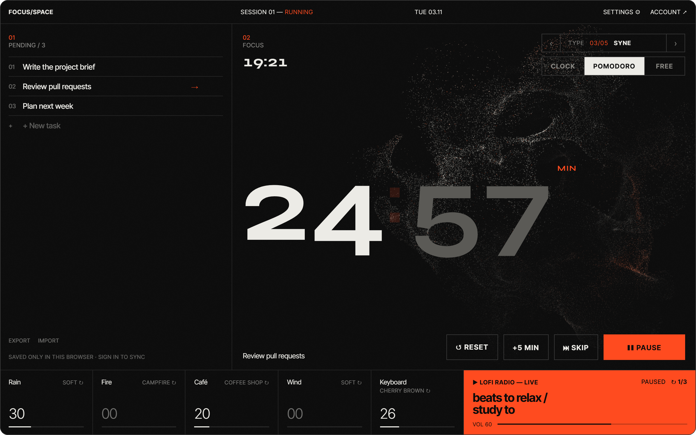
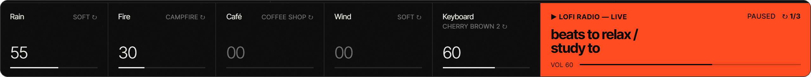
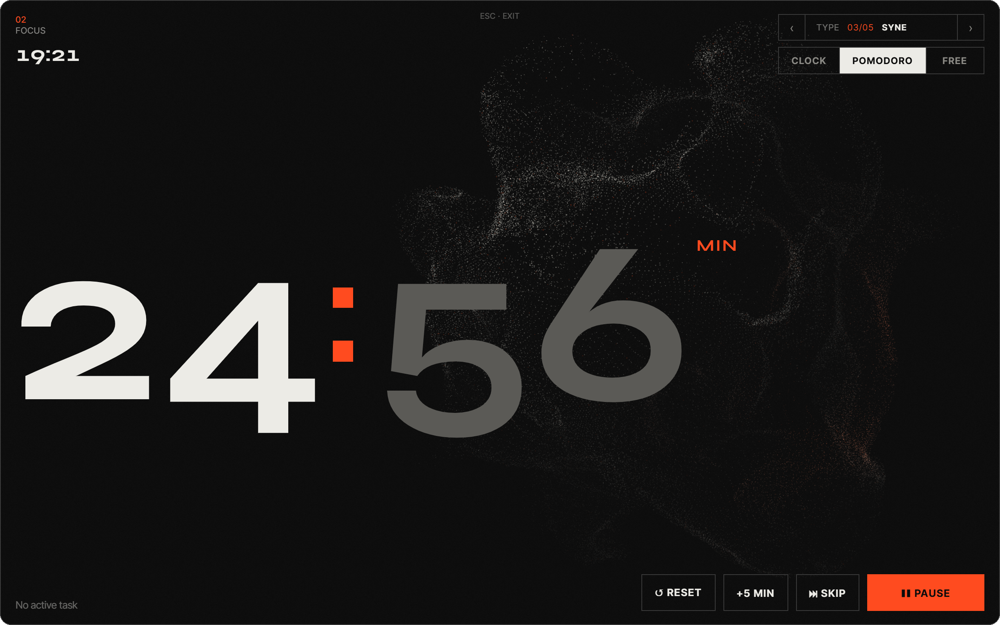
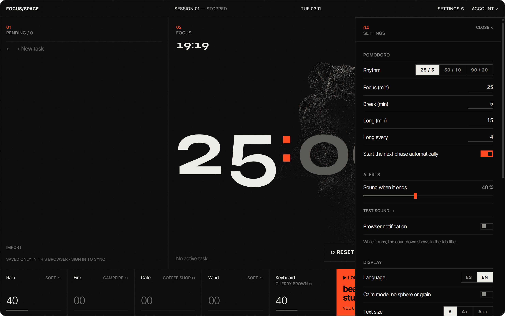
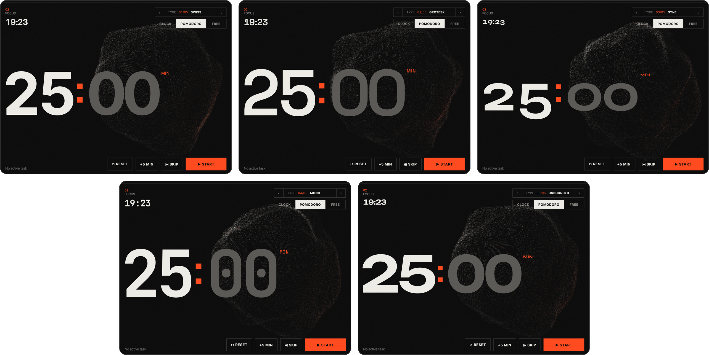
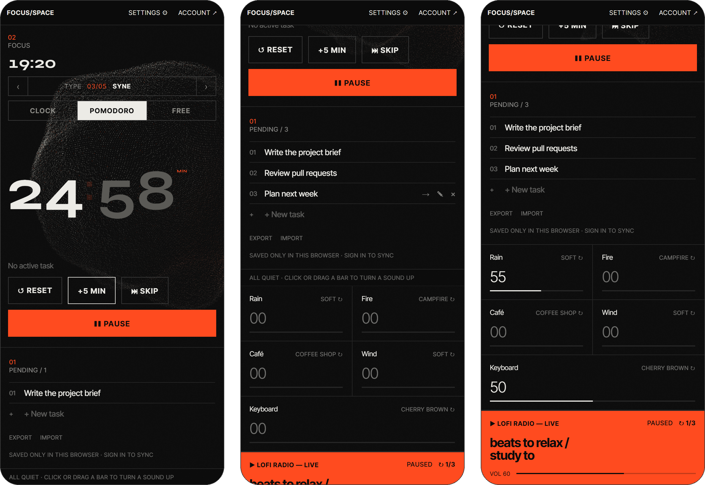

<div align="center">


# Focus/Space

**A focus room for your browser.**<br />
Tasks, a Pomodoro timer, mixable ambient sounds, lofi radio and a particle sphere that breathes with what you hear.<br />
One screen, no account, no setup.

**English** · [Español](README.es.md)

<br />

[](#credits-and-licenses)
[](public/sounds/CREDITS.md)
[](https://react.dev)
[](https://www.typescriptlang.org)
[](https://threejs.org)
[](https://vite.dev)
[](#english-and-spanish)
[](#contributing)

<br />



<sub>A session in progress: tasks on the left, the clock and sphere in the middle, the mixer and radio below.</sub>

</div>

<br />

## Why

Most focus apps are either a bare timer or a dashboard full of things to configure. Focus/Space sits in between: **everything you need to start a session on one screen**, calm enough to keep open all day on a second monitor.

- **Zero setup.** Clone, install, run. Without any config it works in *local-only mode* and saves to your browser.
- **Nothing to sign up for.** Accounts are optional and only add sync between devices.
- **Reliable.** The timer survives a reload and stays exact in background tabs, and its countdown shows in the tab title.
- **Built to be left open.** Dark, quiet, with a 3D scene that follows the sound. Too much? Switch on *calm mode*.

<br />

<div align="center">

<br /><sub><b>Ambient mixer.</b> Five channels with variants, including real Cherry MX keyboard recordings, and the lofi radio.</sub>
</div>

<br />

<div align="center">
<table>
  <tr>
    <td width="50%" valign="top">
      
      <p align="center"><b>Focus mode</b> <kbd>F</kbd><br /><sub>Everything disappears except the clock and the sphere.</sub></p>
    </td>
    <td width="50%" valign="top">
      
      <p align="center"><b>Settings</b><br /><sub>Pomodoro rhythm, alerts, language, text size and calm mode.</sub></p>
    </td>
  </tr>
</table>
</div>

<br />

<div align="center">

<br /><sub><b>Five typefaces for the clock.</b> Each one tuned so the digits keep the same width.</sub>
</div>

## On your phone too

Below 1024&nbsp;px the layout becomes a single column: clock, tasks, mixer and radio, with full-width controls and touch-sized targets. It has a web app manifest, so it can sit on your home screen.

<div align="center">

</div>

## Features

**Timer**
- **Pomodoro and free timer.** 25 / 5 min with a long break every 4, or presets 50 / 10 and 90 / 20, or your own durations. A free timer runs from 1 to 240 min.
- **Yours to steer.** Add 5 minutes, skip a phase, or stop the next phase from starting by itself.
- **Reload-proof.** The running phase is saved with its end time, so closing the tab does not lose it.
- **Alerts that fit how you work.** A countdown in the tab title, an optional browser notification (permission is asked only when you switch it on) and a chime with its own volume, down to *off*.
- **Stats.** Focus time today and over 7 days, and your streak.

**Tasks**
- Add, edit (<kbd>✎</kbd> or double click), complete and delete, with **undo**. Mark one as *active* and it follows you under the clock.
- Clear completed tasks, **export** them as JSON and **import** JSON or a plain list (one task per line, `- [x]` checkboxes work too).
- Local-first: saved in your browser. Sign in (optional) to sync.

**Sound**
- **Five ambient channels:** rain, fire, café, wind and keyboard typing, each with variants (window, storm, tent, fireplace, library, forest, Cherry MX Blue, Brown and Red…).
- Mix with a click, a drag, the wheel or the arrow keys. **Save mixes** by name, **mute everything** in one go.
- **Lofi radio** with its own volume, three stations and automatic fallback if one is down.

**Look**
- A Three.js **particle sphere** (65,536 particles simulated on the GPU, 32,400 on devices with 4 cores or fewer) that follows the ambient channels and the lofi groove.
- Five clock typefaces, film grain, **calm mode** (no sphere or grain), three text sizes and a **focus mode** that grows the clock.

<a id="english-and-spanish"></a>
**English and Spanish.** Pick the language in Settings. It starts in your browser's language and is remembered. Accessible by design: real roles and labels on every control, keyboard-operable sliders and a timer readable by screen readers.

### Keyboard shortcuts

They never fire while you type, with a modifier held, or on a focused button or slider.

| Key | Action |
|---|---|
| <kbd>Space</kbd> | Start / pause the timer |
| <kbd>N</kbd> | New task |
| <kbd>M</kbd> | Mute everything |
| <kbd>C</kbd> | Calm mode |
| <kbd>F</kbd> | Focus mode (<kbd>Esc</kbd> to leave) |
| <kbd>?</kbd> | Open / close settings |

## Quick start

You need a recent version of [Bun](https://bun.sh).

```bash
git clone https://github.com/envyx10/focus-space.git
cd focus-space
bun install
bun run dev
```

Open <http://localhost:5173>. That's it: tasks and preferences live in your browser.

> **Tip:** browsers block audio until you interact with the page. Click anywhere once and your saved mix will start.

### Accounts and sync (optional)

To sync tasks between devices you need a free [Supabase](https://supabase.com) project:

1. Run [`supabase/schema.sql`](supabase/schema.sql) in the Supabase SQL editor.
2. Copy `.env.example` to `.env.local` and fill in your project URL and `anon` key:

   ```env
   VITE_SUPABASE_URL=https://<project-ref>.supabase.co
   VITE_SUPABASE_ANON_KEY=<anon-public-key>
   ```

3. Restart `bun run dev`. The **Account** menu now lets you sign in.

The full guide (email, Google, GitHub and deploying to Netlify) is in [docs/SETUP.md](docs/SETUP.md).

## Scripts

| Command | What it does |
|---|---|
| `bun run dev` | Dev server with hot reload |
| `bun run build` | Type-check and build to `dist/` |
| `bun run preview` | Serve the production build locally |
| `bun run test` | Run the test suite (Vitest + Testing Library) |
| `bun run lint` | Lint with oxlint |

## How it works

```
src/
├── timer/      Pomodoro and free timer: pure state machine, persistence, alerts
├── tasks/      Task list with a local repo (localStorage) and a Supabase repo
├── audio/      Web Audio engine, mixer, channels and level analysis
├── lofi/       YouTube lofi player with station fallback
├── visual/     Three.js particle sphere, GLSL shaders, typefaces, film grain
├── settings/   Settings panel
├── stats/      Focus time per day and streaks
├── i18n/       Dictionaries (es, en), provider and language detection
├── auth/       Supabase session and account menu
├── prefs/      Volumes, mixes and display options, persisted in the browser
├── lib/        Storage helpers and keyboard shortcuts
└── layout/     Header
```

- **The timer** keeps the wall-clock end time instead of counting ticks, so it stays exact in background tabs, and the whole state is saved so it survives a reload.
- **The sphere** reads levels from a Web Audio `AnalyserNode` on each ambient channel. YouTube's iframe can't be analysed directly, so while lofi plays it follows a synthetic groove.
- **Three.js is lazy-loaded** after the first paint, so the clock and tasks show up instantly.
- **Tasks are local-first.** On your first sign-in your browser tasks are merged into your account (the remote copy wins conflicts and duplicates are dropped).
- **Translations are plain objects.** `src/i18n/es.ts` is the source; `en.ts` must have every key (the compiler and a test enforce it).

## Tech stack

[React 19](https://react.dev) · [TypeScript](https://www.typescriptlang.org) · [Vite](https://vite.dev) · [Three.js](https://threejs.org) + GLSL · Web Audio API · [Supabase](https://supabase.com) (Auth + Postgres with RLS) · [Vitest](https://vitest.dev) + [Testing Library](https://testing-library.com) · [oxlint](https://oxc.rs) · [Bun](https://bun.sh) · [Netlify](https://netlify.com)

## Privacy

There is no analytics and no tracking. Everything stays in your browser unless you configure Supabase and sign in. Two things load from third parties, as in any site that uses them: the clock typefaces come from **Google Fonts**, and the lofi radio is an official **YouTube** embed.

## Contributing

It's a small project and contributions are welcome: ambient sounds, typefaces, translations or bug fixes.

1. Fork the repo and create a branch: `git checkout -b feat/my-idea`
2. Make your change and keep `bun run test` and `bun run lint` green.
3. Open a pull request explaining what it changes and why.

Adding a language means copying `src/i18n/en.ts`, translating it and registering it in `src/i18n/index.tsx`. New sounds must be **CC0** (or otherwise free to redistribute) and listed in [public/sounds/CREDITS.md](public/sounds/CREDITS.md). By contributing you agree your code is released under the project's license (FSL-1.1-MIT) and that the author may relicense it.

Ideas or bugs? [Open an issue](https://github.com/envyx10/focus-space/issues).

## Credits and licenses

Everything in this repository is free to read and use, but not everything is under the same license. Here is the whole picture.

| What | License | Details |
|---|---|---|
| **Source code** | [FSL-1.1-MIT](LICENSE), © 2026 envyx10 | Use it, modify it and self-host it for any purpose except a **competing commercial product or service**. Each version turns into plain MIT two years after its release. Versions published before this change remain under MIT. |
| **Ambient and keyboard sounds**, chime | **CC0 1.0** (public domain) | Real recordings by [Freesound](https://freesound.org) authors. No attribution is required, but every file and author is listed in [public/sounds/CREDITS.md](public/sounds/CREDITS.md). The keyboard clips are trimmed, looped and level-matched. |
| **Screenshots** (`docs/media`) | FSL-1.1-MIT, like the code | Captures of this app, taken for this README. |
| **Clock typefaces** | [SIL Open Font License 1.1](https://openfontlicense.org) | Inter Tight, Space Grotesk, Syne, JetBrains Mono and Unbounded, loaded from [Google Fonts](https://fonts.google.com) at run time. They are not bundled here. |
| **Dependencies** | MIT (12) and 0BSD (1) in the shipped bundle | React, Three.js and Supabase's client, among others. Full list with versions in [THIRD_PARTY_LICENSES.md](THIRD_PARTY_LICENSES.md). |
| **Lofi radio** | Not part of this repository | An official YouTube embed. The streams belong to their owners and YouTube's terms apply. Focus/Space does not download, record or redistribute them. |

**Name and branding.** The name *Focus/Space*, its logo and its visual identity are not licensed. You may fork the code under the license above, but not present your fork as the original or reuse the name or logo.

**Trademarks.** *Cherry MX* is a trademark of Cherry GmbH and is used here only to describe the keyboard switches that were recorded. *Pomodoro Technique* is a registered trademark of Francesco Cirillo. React, Three.js, Supabase, Vite, TypeScript, YouTube and the other names and logos in the badges belong to their owners. Focus/Space is an independent project, not affiliated with or endorsed by any of them.

<div align="center">
<sub>Made for long focus sessions. If it helps you, a ⭐ helps others find it.</sub>
</div>
