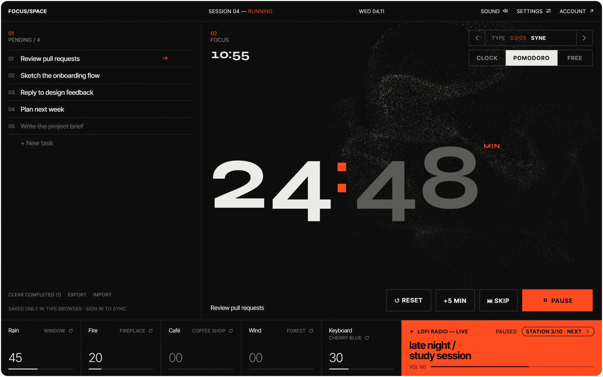
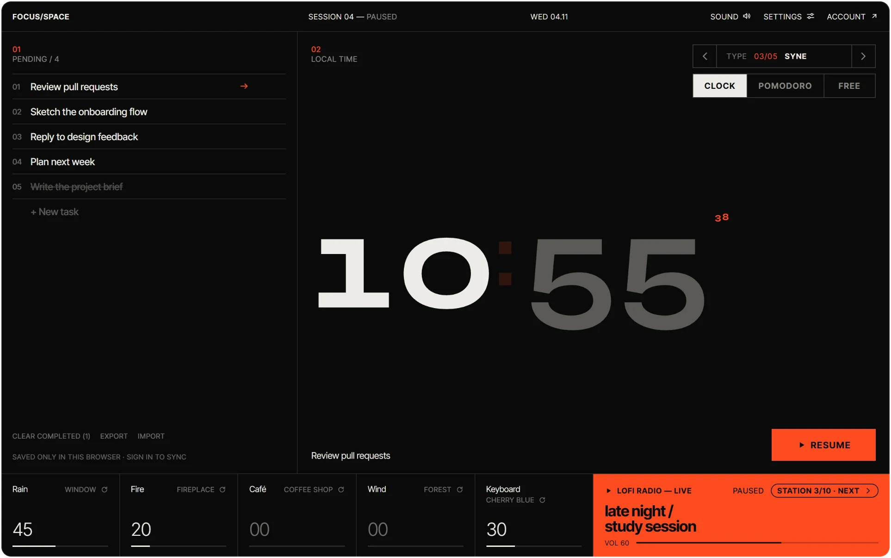
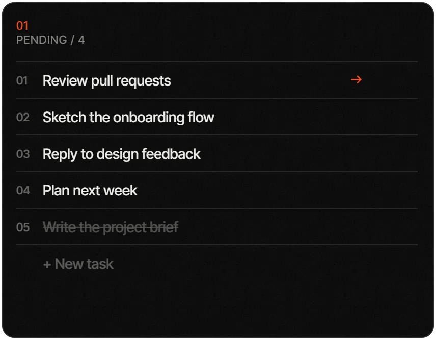
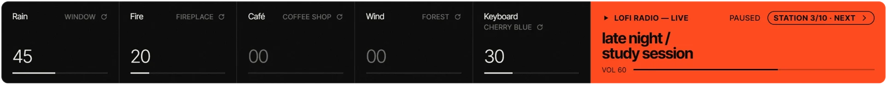
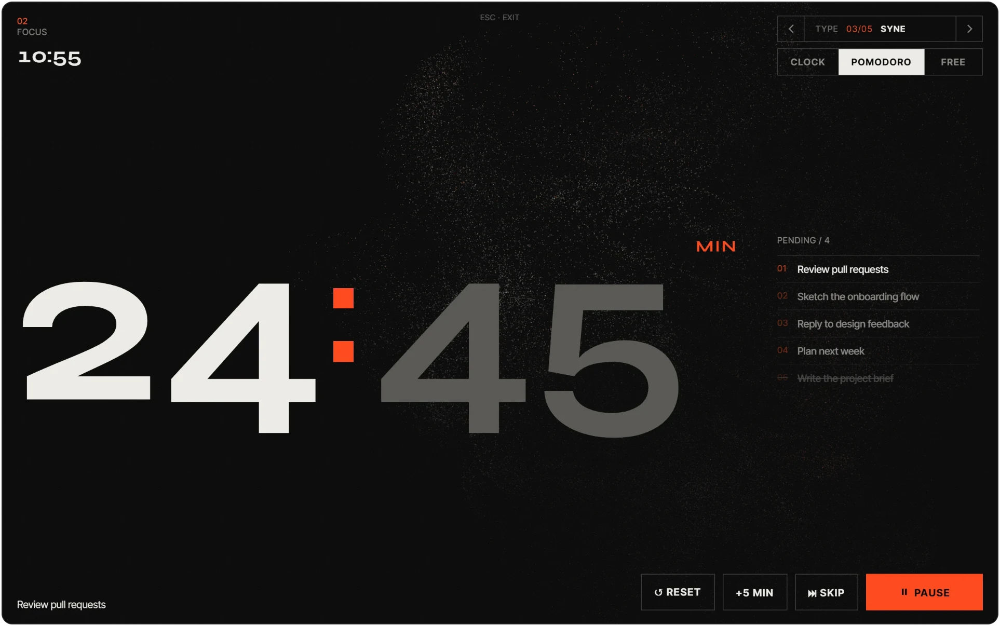
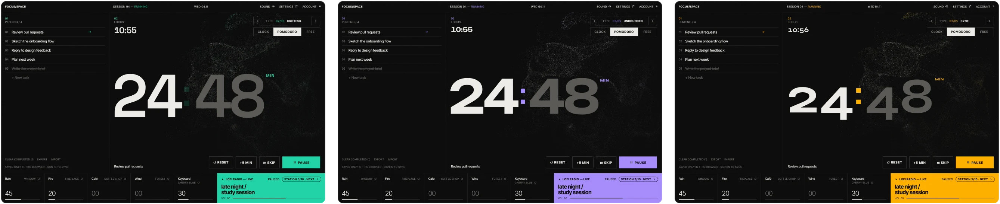
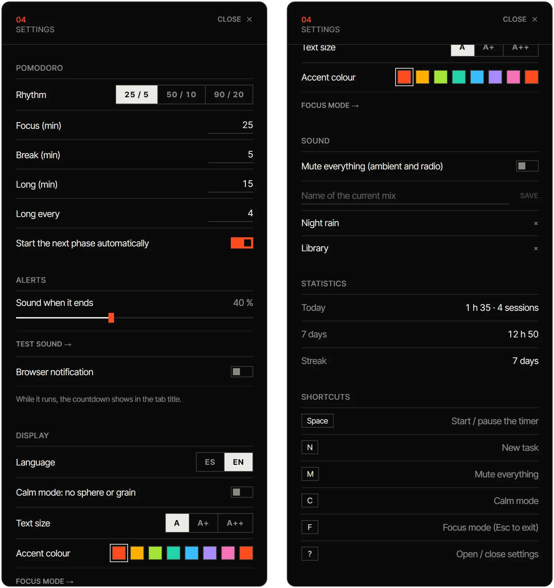
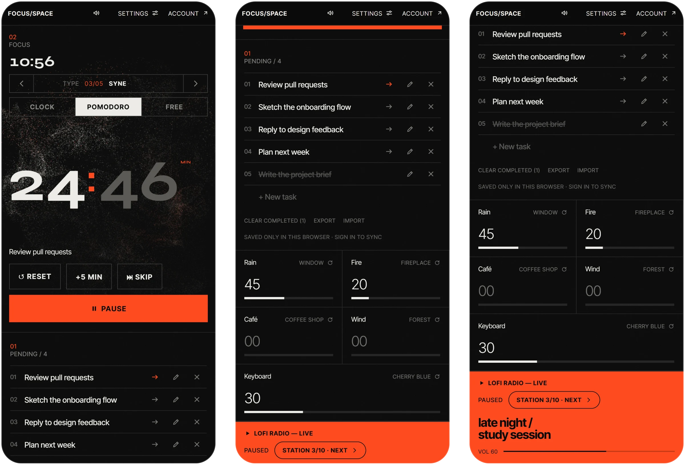

<div align="center">


# Focus/Space

### A quiet room for deep work, in a browser tab.

Tasks, a Pomodoro timer, an ambient sound mixer, lofi radio and a particle sphere that moves with what you hear.<br />
All on one screen. No account, no setup.

<br />

[](#credits-and-licenses)
[](public/sounds/CREDITS.md)
[](#tech-stack)
[](#the-details)

**English** · [Español](README.es.md)

<sub>[The idea](#the-idea) · [Features](#features) · [Quick start](#quick-start) · [How it works](#how-it-works) · [Contributing](#contributing)</sub>

<br />



<sub>A session in progress: tasks on the left, clock and sphere in the middle, mixer and radio along the bottom.</sub>

</div>

<br />

## The idea

Most focus apps are either a bare timer or a dashboard full of settings. Focus/Space sits in between. It puts **everything you need to start a session on one screen**, and it's calm enough to leave open all day on a second monitor.

You open the tab, pick what you're working on, start the clock and turn up some rain. That's the whole routine.

<table>
  <tr>
    <td width="33%" valign="top">
      <b>One screen</b><br />
      <sub>Timer, tasks, sound and radio share a single view. No menus to dig through to begin.</sub>
    </td>
    <td width="33%" valign="top">
      <b>Nothing to sign up for</b><br />
      <sub>Works straight away and saves to your browser. An account is optional and only adds sync.</sub>
    </td>
    <td width="33%" valign="top">
      <b>Built to stay open</b><br />
      <sub>Dark, quiet and exact: the timer survives a reload and keeps time in background tabs.</sub>
    </td>
  </tr>
</table>

<br />

<a id="features"></a>

<sub>01 — TIMER</sub>

## Three ways to keep time

A large clock is the centre of the screen. Switch it between three modes with one click.

| Mode | What it does |
|---|---|
| **Clock** | Shows the local time, big and readable from across the room. |
| **Pomodoro** | 25 / 5 with a long break every 4. Presets for 50 / 10 and 90 / 20, or set your own durations. |
| **Free** | A plain countdown from 1 to 240 minutes. |

- **You stay in control.** Add 5 minutes, skip a phase, or stop the next phase from starting by itself.
- **Reload-proof.** The running phase is saved with its end time, so closing the tab doesn't lose it.
- **Alerts that suit you.** A countdown in the tab title, an optional browser notification and a chime with its own volume, down to *off*.
- **Stats.** Focus time today and over the last 7 days, plus your current streak.

<div align="center">

<br /><sub><b>Clock view with calm mode on.</b> The sphere and film grain step aside for an even quieter screen.</sub>
</div>

<br />

<sub>02 — TASKS</sub>

## A short list, always in sight

<table>
  <tr>
    <td width="44%" valign="top">
      
    </td>
    <td valign="top">
      <p>Write down what you're about to do, then mark one task as <b>active</b>. It follows you under the clock, so you always know what this session is for.</p>
      <ul>
        <li>Add, edit (<kbd>✎</kbd> or double click), complete and delete.</li>
        <li><b>Undo</b> a deletion with the button or <kbd>Ctrl</kbd>/<kbd>⌘</kbd> + <kbd>Z</kbd>.</li>
        <li><kbd>Backspace</kbd> in the empty new-task box removes the last task.</li>
        <li>Clear completed tasks, <b>export</b> them as JSON and <b>import</b> JSON or a plain list (one per line; <code>- [x]</code> checkboxes work too).</li>
        <li>Local-first. Sign in (optional) to sync between devices.</li>
      </ul>
    </td>
  </tr>
</table>

<br />

<sub>03 — SOUND</sub>

## Your own background, mixed by hand

Five ambient channels you can layer, each with real recordings to choose from. Next to them, a lofi radio with its own volume.

<div align="center">

</div>

<br />

<table>
  <tr>
    <td width="50%" valign="top">
      <b>Ambient mixer</b>
      <ul>
        <li><b>Rain</b> (soft, window, storm, tent), <b>fire</b> (campfire, fireplace), <b>café</b> (coffee shop, library), <b>wind</b> (soft, forest) and <b>keyboard</b> typing recorded on Cherry MX Blue, Brown and Red switches.</li>
        <li><b>Generated in the browser</b>: soft, dark sounds for headaches (deep noise, slow swell, warm hum), <b>frequencies</b> (alpha, theta, delta and beta binaural beats, 432 and 528 Hz) and <b>spatial</b> sounds that move around your head (orbit, chimes, sway). Binaural and spatial sounds need headphones. They are for comfort, not a medical treatment.</li>
        <li>Mix with a click, a drag, the mouse wheel or the arrow keys.</li>
        <li><b>Save mixes</b> by name and switch between them.</li>
        <li><b>Mute everything</b> with <kbd>M</kbd>. The header shows when sound is off.</li>
      </ul>
    </td>
    <td width="50%" valign="top">
      <b>Lofi radio</b>
      <ul>
        <li><b>Ten stations</b>: late-night study beats, jazzy coffee-shop lofi, rainy café, gaming lofi, Disney piano and more.</li>
        <li>Its own volume, separate from the ambient mix.</li>
        <li>If a stream goes down, the radio skips to the next station by itself.</li>
      </ul>
    </td>
  </tr>
</table>

<br />

<sub>04 — FOCUS MODE</sub>

## Everything else disappears

Press <kbd>F</kbd> and the interface steps back. The clock grows to fill the screen, the browser goes fullscreen, and your task list stays beside it as a quiet, read-only column. <kbd>Esc</kbd> brings everything back.

<div align="center">

</div>

**The sphere.** Behind the clock, a Three.js sphere of 65,536 particles (32,400 on devices with 4 cores or fewer) is simulated entirely on the GPU. It follows the level of each ambient channel and the groove of the lofi radio, so the screen breathes with what you hear.

<br />

<sub>05 — CUSTOMIZATION</sub>

## Make the room yours

<div align="center">

<br /><sub><b>Any accent colour.</b> Seven quick picks or any colour you like. Text on the accent switches between dark and light to stay readable.</sub>
</div>

<br />

<div align="center">

<br /><sub><b>Five typefaces for the clock.</b> Swiss, Grotesk, Syne, Mono and Unbounded, each tuned so the digits keep the same width.</sub>
</div>

<br />

<table>
  <tr>
    <td width="50%" valign="top">
      
    </td>
    <td width="50%" valign="top">
      <b>Settings, all in one panel</b> <kbd>?</kbd>
      <ul>
        <li><b>Pomodoro rhythm</b>: presets or your own focus, break and long-break lengths.</li>
        <li><b>Alerts</b>: chime volume and browser notifications.</li>
        <li><b>Display</b>: language, calm mode, three text sizes and the accent colour.</li>
        <li><b>Sound</b>: mute everything and manage your saved mixes.</li>
        <li><b>Statistics</b>: today, the last 7 days and your streak.</li>
        <li><b>Shortcuts</b>: a reminder of every key.</li>
      </ul>
      <sub>Everything is remembered in your browser.</sub>
    </td>
  </tr>
</table>

<br />

<sub>06 — MOBILE</sub>

## On your phone too

Below 1024&nbsp;px the layout becomes a single column: clock, tasks, mixer and radio, with full-width controls and touch-sized targets. It ships a web app manifest, so you can add it to your home screen.

<div align="center">

</div>

<br />

<a id="the-details"></a>

## The details

**English and Spanish.** Choose the language in Settings. It starts in your browser's language and is remembered.

**Accessible by design.** Every control has a real role and label, sliders work with the keyboard, and the timer is readable by screen readers.

**Keyboard shortcuts.** They never fire while you type, with a modifier held, or on a focused button or slider.

| Key | Action |
|---|---|
| <kbd>Space</kbd> | Start / pause the timer |
| <kbd>N</kbd> | New task |
| <kbd>M</kbd> | Mute everything |
| <kbd>C</kbd> | Calm mode |
| <kbd>F</kbd> | Focus mode (<kbd>Esc</kbd> to leave) |
| <kbd>?</kbd> | Open / close settings |

<br />

---

<br />

<div align="center">

### For developers

<sub>Run it locally, add sync, or look under the hood.</sub>

</div>

## Quick start

You need a recent version of [Bun](https://bun.sh).

```bash
git clone https://github.com/envyx10/focus-space.git
cd focus-space
bun install
bun run dev
```

Open <http://localhost:5173>. That's it: tasks and preferences live in your browser.

> **Tip:** browsers block audio until you interact with the page. Click anywhere once and your saved mix will start.

### Accounts and sync (optional)

To sync tasks between devices you need a free [Supabase](https://supabase.com) project:

1. Run [`supabase/schema.sql`](supabase/schema.sql) in the Supabase SQL editor.
2. Copy `.env.example` to `.env.local` and fill in your project URL and `anon` key:

   ```env
   VITE_SUPABASE_URL=https://<project-ref>.supabase.co
   VITE_SUPABASE_ANON_KEY=<anon-public-key>
   ```

3. Restart `bun run dev`. The **Account** menu now lets you sign in.

Without these variables the app runs in *local-only mode*. The full guide (email, Google, GitHub and deploying to Netlify) is in [docs/SETUP.md](docs/SETUP.md).

## Scripts

| Command | What it does |
|---|---|
| `bun run dev` | Dev server with hot reload |
| `bun run build` | Type-check and build to `dist/` |
| `bun run preview` | Serve the production build locally |
| `bun run test` | Run the test suite (Vitest + Testing Library) |
| `bun run lint` | Lint with oxlint |

## How it works

```
src/
├── app/            Composition: picks the layout and wires the shared state
│   ├── hooks/      useAppState (one state for both layouts), clock, immersive mode
│   ├── desktop/    The desktop grid and its header
│   └── mobile/     The phone shell: tabs, views, sheets and touch components
├── features/       One folder per domain, each with its components, hooks and logic
│   ├── timer/      Pomodoro and free timer: pure state machine, persistence, alerts
│   ├── tasks/      Task list: local and Supabase repos, ordering, import and export
│   ├── audio/      Web Audio engine, mixer, channels and level analysis
│   ├── lofi/       YouTube lofi player with station fallback
│   ├── visual/     Three.js particle sphere, GLSL shaders, typefaces, film grain
│   ├── break/      Breathing invite and game for the breaks
│   ├── settings/   Settings panel, its options and controls
│   ├── stats/      Focus time per day and streaks
│   ├── auth/       Supabase session, sign-in actions and account menu
│   ├── prefs/      Volumes, mixes, accent colour and display options, persisted in the browser
│   └── weather/    Local weather for the header
├── shared/         Code with no domain: UI primitives, hooks and formatting helpers
├── i18n/           Dictionaries (es, en) split by area, provider and language detection
└── styles/         Design tokens and the global stylesheet
```

Imports go through the `@/` alias (`@/features/tasks/...`); only files in the same folder use relative paths.

- **The timer** keeps the wall-clock end time instead of counting ticks, so it stays exact in background tabs, and the whole state is saved so it survives a reload.
- **The sphere** reads levels from a Web Audio `AnalyserNode` on each ambient channel. YouTube's iframe can't be analysed directly, so while lofi plays it follows a synthetic groove.
- **Three.js is lazy-loaded** after the first paint, so the clock and tasks show up instantly.
- **Tasks are local-first.** On your first sign-in your browser tasks are merged into your account (the remote copy wins conflicts and duplicates are dropped).
- **Translations are plain objects.** `src/i18n/locales/es/` is the source; `locales/en/` must have every key (the compiler and a test enforce it).

## Tech stack

[React 19](https://react.dev) · [TypeScript](https://www.typescriptlang.org) · [Vite](https://vite.dev) · [Three.js](https://threejs.org) + GLSL · Web Audio API · [Supabase](https://supabase.com) (Auth + Postgres with RLS) · [Vitest](https://vitest.dev) + [Testing Library](https://testing-library.com) · [oxlint](https://oxc.rs) · [Bun](https://bun.sh) · [Netlify](https://netlify.com)

## Privacy

There is no analytics and no tracking. Everything stays in your browser unless you configure Supabase and sign in. Two things load from third parties, as in any site that uses them: the clock typefaces come from **Google Fonts**, and the lofi radio is an official **YouTube** embed.

## Contributing

It's a small project and contributions are welcome: ambient sounds, typefaces, translations or bug fixes.

1. Fork the repo and create a branch: `git checkout -b feat/my-idea`
2. Make your change and keep `bun run test` and `bun run lint` green.
3. Open a pull request explaining what it changes and why.

Adding a language means copying `src/i18n/locales/en/`, translating it and registering it in `src/i18n/translate.ts`. New sounds must be **CC0** (or otherwise free to redistribute) and listed in [public/sounds/CREDITS.md](public/sounds/CREDITS.md).

By opening a pull request you agree to the terms in [CONTRIBUTING.md](CONTRIBUTING.md): your code is released under FSL-1.1-MIT, the author may relicense it, and your commits are signed off (`git commit -s`).

Ideas or bugs? [Open an issue](https://github.com/envyx10/focus-space/issues).

## Credits and licenses

Everything in this repository is free to read and use, but not everything is under the same license. Here is the whole picture.

| What | License | Details |
|---|---|---|
| **Source code** | [FSL-1.1-MIT](LICENSE), © 2026 Pablo Gil Diaz (envyx10) | Use it, modify it and self-host it for any purpose except a **competing commercial product or service**. Each version turns into plain MIT two years after the date it was published. Versions published before commit `f79c394` (3 November 2026) remain under MIT. |
| **Logo and icons** | **All rights reserved**, not under FSL | `docs/media/logo.svg`, `public/favicon.svg` and `public/icon-512.png`. See [TRADEMARK.md](TRADEMARK.md). Replace them in your fork. |
| **Ambient and keyboard sounds**, chime | **CC0 1.0** (public domain) | Real recordings by [Freesound](https://freesound.org) authors. No attribution is required, but every file and author is listed in [public/sounds/CREDITS.md](public/sounds/CREDITS.md). The keyboard clips are trimmed, looped and level-matched. |
| **Screenshots** (`docs/media`) | FSL-1.1-MIT, like the code | Captures of this app, taken for this README. |
| **Clock typefaces** | [SIL Open Font License 1.1](https://openfontlicense.org) | Inter Tight, Space Grotesk, Syne, JetBrains Mono and Unbounded, loaded from [Google Fonts](https://fonts.google.com) at run time. They are not bundled here. |
| **Dependencies** | MIT (84), ISC (1), BSD-3-Clause (1) and 0BSD (1) in the shipped bundle | React, Three.js, Supabase's client and the Markdown renderer, among others. Their full license texts are served at `/licenses.txt`. Full list with versions in [THIRD_PARTY_LICENSES.md](THIRD_PARTY_LICENSES.md). |
| **Lofi radio** | Not part of this repository | An official YouTube embed. The streams belong to their owners and YouTube's terms apply. Focus/Space does not download, record or redistribute them. |

**Name and branding.** The name *Focus/Space*, its logo and its visual identity are not licensed. You may fork the code under the license above, but not present your fork as the original or reuse the name or logo. The rules, with examples, are in [TRADEMARK.md](TRADEMARK.md).

### Licensing questions

**What is a "version"?** Every commit counts as a version, and its two years start on the commit's date. The code of any commit older than two years is plain MIT. The repository has no tags, so use `git log` for the date.

**Can I use it, self-host it or change it?** Yes, for yourself, your team or your company, including inside a commercial setting that is not a product built on it.

**Can I fork it and publish it for free?** Yes, if it is non-commercial and you follow the rules: keep the license and copyright notices, and use your own name and logo.

**Can I sell it, put ads on it, or offer it as a paid or hosted service?** Not while it is under FSL. A commercial product or service that does the same as Focus/Space is a "Competing Use". Write to me first if you want a licence for that.

**Can I learn from it, or use pieces in something different?** Yes. Using parts of it in a product that does something else is allowed.

**What about someone who rebuilds it without using this code?** The license covers the code, not the idea or how it looks. That is why the name, the logo and the visual identity are protected separately.

**What did I get under MIT before?** The versions published before commit `f79c394` (3 November 2026) stay under MIT. That grant cannot be withdrawn.

This section is a summary to help you read the license. If they differ, the [LICENSE](LICENSE) text prevails. It is not legal advice.

**Trademarks.** *Cherry MX* is a trademark of Cherry GmbH and is used here only to describe the keyboard switches that were recorded. *Pomodoro Technique* is a registered trademark of Francesco Cirillo. React, Three.js, Supabase, Vite, TypeScript, YouTube and the other names and logos in the badges belong to their owners. Focus/Space is an independent project, not affiliated with or endorsed by any of them.

<br />

<div align="center">

<br />
<sub>Made for long focus sessions. If it helps you, a ⭐ helps others find it.</sub>
</div>
